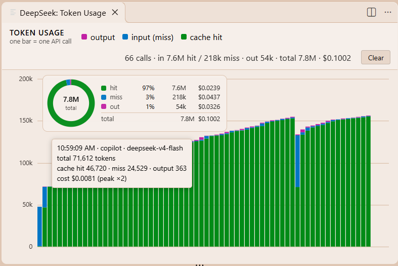

# SmarterCode DeepSeek
**Version: 0.0.50**

> **⚠️ IMPORTANT NOTE — Production & Preview Features**
>
> The **Copilot Integration** (using DeepSeek as a VS Code Language Model Chat Provider) is at **production level** and ready for daily use.
>
> The **Zero panel** is an experimental, self-contained agent harness. It is functional but may see breaking changes as it is refined.
>
> Feedback and contributions are welcome — they help shape the final features!

SmarterCode DeepSeek extension is heavily focusing on reducing token usage and includes detailed usage profiling capabilities:



## Quick Start

1. Configure a key: set `deepseek.apiKey`, store it with **DeepSeek: Set API Key**, or enter it when VS Code prompts while adding DeepSeek in **Manage Models**. Alternatively, run **DeepSeek: Sign In for Free Tokens** to use the hosted monthly allowance described in [§2](#2-usage) — no DeepSeek key needed.
2. Open VS Code Chat (`Ctrl+Shift+I`). The model button in the chat input shows the current model — usually a Copilot model such as **Copilot Fusion: Standard**.
3. Click that model button, then switch to the **DeepSeek** provider tab and pick **DeepSeek V4 Flash** or **DeepSeek V4 Pro**. VS Code always opens the picker on its Copilot tab; third-party providers get their own tab.
4. Start asking questions or requesting code changes — DeepSeek works just like Copilot.

> If **DeepSeek** does not appear in the picker, open **Manage Models...** (or **Add Models...**) from the picker, select **DeepSeek**, and enable its models. The extension cannot reorder the picker, change its icons, or pre-select a model — that UI belongs to VS Code. To make new chats *start* on DeepSeek, run **DeepSeek: Use as Default Chat Model** (or set the built-in `chat.defaultModel` setting — see [§3](#3-configuration-reference)).

> The **Zero** activity-bar panel is described in [§2](#2-usage).

> For more updates, subscribe to [zikalino.substack.com](https://zikalino.substack.com).

## Table of Contents

1. [Overview](#1-overview)
2. [Usage](#2-usage)
3. [Configuration Reference](#3-configuration-reference)
4. [Commands Reference](#4-commands-reference)
5. [Architecture Overview](#5-architecture-overview)
6. [Build & Install](#6-build--install)

---

## 1. Overview

**SmarterCode DeepSeek** is a VS Code extension that brings DeepSeek's language models (V4 Flash & V4 Pro) directly into your editor. It goes beyond a simple chat wrapper by providing:

- **Copilot integration** — Use DeepSeek in VS Code Chat. Ask questions, request code changes, search your codebase — all from `Ctrl+Shift+I`. VS Code's model picker opens on the Copilot tab; the DeepSeek models live on their own provider tab.
- **Zero panel (WASM)** — A self-contained agent panel — conversation, history, tasks, tools, workflows and settings — with its agent loop shipped as `advance_harness.wasm`, and an Activity Bar icon of its own.
- **Failure diagnostics** — Failed requests are dumped to `.smartercode/deepseek-failures/` and can be browsed from the command palette. Requests that miss most of the prompt cache are recorded to `.smartercode/deepseek-cache/`.

---

## 2. Usage

### Configuration — Copilot Integration Mode

API routing is handled automatically via the DeepSeek Copilot provider. Configure a DeepSeek API key, or sign in for the hosted allowance, as described in [Quick Start](#quick-start); no endpoint configuration is needed unless you use a proxy.

To point to a different API endpoint (e.g., a self-hosted proxy), set `deepseek.apiEndpoint` in settings.

### Hosted Tokens (optional)

Instead of a DeepSeek key, you can sign in with GitHub and use a monthly token allowance served by
the quota proxy in [`server/`](server/README.md):

- **Any signed-in account** gets the free allowance.
- **Active GitHub Sponsors** of the maintainer get the larger allowance.

Sign-in uses the GitHub OAuth **device flow** (no redirect URI, no client secret) and requests only
`read:user`. The proxy verifies the identity server-side and meters usage by GitHub account; the
DeepSeek key never reaches the extension. Without a session, the extension falls back to the key
configured above, so signing in is never required.

> The allowance is implemented entirely on the proxy — a counter in the extension could be edited.
> Run the reference proxy with `DEEPSEEK_API_KEY=... node server/index.mjs`, then set
> `deepseek.account.proxyUrl` and `deepseek.account.githubClientId`.

---

### Using with Copilot

After configuring your API key, the quickest way to start is through VS Code's built-in chat:

1. Open VS Code Chat — `Ctrl+Shift+I` (Windows/Linux) or `Cmd+Shift+I` (macOS).
2. Click the model button in the chat input. It shows the selected model (for example **Copilot Fusion: Standard**).
3. Switch to the **DeepSeek** provider tab and select **DeepSeek V4 Flash** or **DeepSeek V4 Pro**. Pin the model if you want it to stay at the top of the list.
4. Start typing your question

> DeepSeek V4 Flash is optimized for speed; V4 Pro offers deeper reasoning. Switch between them per conversation.

> VS Code owns the model picker: extensions contribute provider tabs and model entries, but cannot change the picker's icons, ordering, or selected model. If **DeepSeek** is missing, use **Manage Models...** / **Add Models...** in the picker and enable the DeepSeek models. To start every new chat on DeepSeek, run **DeepSeek: Use as Default Chat Model**, or set `"chat.defaultModel": "deepseek-v4-flash"` (or `"deepseek-v4-pro"`) in your user settings.

**What you can do in Copilot:**
- Ask questions about your codebase — DeepSeek uses VS Code tools to search, read, and understand your project.
- Request code changes — it can read files, propose edits, and explain the reasoning.
- Attach images — they're automatically described and injected into context.

---

### DeepSeek Request Logs, Failures & Token Costs

The extension logs all DeepSeek API activity to the **DeepSeek** output channel, with timestamped entries for each request and token/cost summaries.

**Failed requests:**

A request that fails — an HTTP error such as 502, or a network error — is written as one JSON file to `.smartercode/deepseek-failures/` in the workspace. Each dump carries the status, the error, and the exact request and response bodies. The newest 50 dumps are kept, and `.smartercode/` is git-ignored. When no workspace folder is open, dumps go to the system temp directory's `deepseek-failures` folder instead of being dropped.

Run **DeepSeek: Browse Failed Requests** from the command palette to list them. Selecting a row opens the request body, the response body, or the full dump.

**Prompt-cache diagnostics:**

A request that misses most of the prompt cache is recorded as `.smartercode/deepseek-cache/last-miss.json`, with a timestamped copy of the newest 20. The record separates the three blocks that form the cached prefix — tool definitions, system message and conversation — reporting each block's size, fingerprint and what changed since the previous request (`tools` added/removed/reordered, `system.changed`, `messages.prefixOverlapRatio`). It also records the *serialized* history (`messages.wirePrefixOverlapRatio`, `messages.wireDivergedAt`) and how earlier assistant turns got their `reasoning_content` (`reasoning.injectedTurns` vs `reasoning.markerTurns`); `vision` is present when the request carried images. Token counts alone cannot tell "the conversation grew" from "the tool list was re-registered"; this record can.

Tool definitions are also sorted by name before they are sent, so MCP registration timing or a subagent selection cannot reorder the prompt and invalidate the cache on every resume.

**Understanding token usage:**

The output channel reports each turn's cache-miss (`M:`), cache-hit (`H:`) and output (`O:`) token counts. Switch between the cheaper Flash model and the deeper-reasoning Pro model in the chat model picker; `deepseek.model` only selects the model used by the Zero panel.

**Token usage graph:** run **DeepSeek: Show Token Usage Graph** (or press the graph icon in the Zero view's title bar) to open a live chart with one thin bar per API call. The bar's height is the call's total tokens; the stacked slices are output at the top, uncached input — the cache miss — in the middle, and cache-hit input at the bottom. Hover a bar for its exact counts, model, source and time. Each bar also carries a dollar cost, priced from its own model and hour: the built-in off-peak DeepSeek prices, doubled inside the peak windows (01:00–04:00 and 06:00–10:00 UTC, Monday–Friday) — a peak bar's tooltip says so. The chart updates as each request completes, for both Copilot turns and Zero turns. Samples are shared across VS Code windows and kept for the running VS Code session, and **Clear** empties them. The API itself is stateless, so a bar means one request, not one conversation total.

For deeper diagnostics, set `deepseek-copilot.debugMode` to `"metadata"` or `"verbose"`; request summaries and token usage are logged to the DeepSeek output channel. In `"verbose"` mode the full request body is logged too (truncated); with the default `"minimal"`/`"metadata"` levels only the summary is written, because a long conversation's body is several megabytes and would rotate the output channel away within a minute. In `"verbose"` mode each request also reports:

- `prefixOverlap` — share of the shorter message list shared with the previous request. `1.00` means the previous request was a prefix (a normal append); lower means history was dropped, reordered or re-serialized. This compares raw text only, so tool results, tool calls and `reasoning_content` are invisible to it.
- `divergedAt=#N(role->role a->b chars)` — the first message that differed, with its index, roles and text lengths.
- `wireOverlap` / `wireDivergedAt=#N(role->role reason)` — the same comparison over the messages actually sent to DeepSeek, including tool calls, tool results and `reasoning_content` (`reason` is `role`, `content`, `reasoning`, `toolCalls` or `toolCallId`).
- `reasoning=<n>injected/<m>marker` — earlier assistant turns whose reasoning was replayed from the cache, versus turns sent with the "(no reasoning recorded for this turn)" placeholder.
- `contextShrank` — the message list got shorter without a differing message, i.e. turns were removed from the end.
- `toolsChanged` — the ordered tool list differs from the previous request, which invalidates everything rendered after the system message.
- On completion, `H:<hit>/<prompt> (<pct>%)` — cache-hit tokens against the whole prompt.

When the hit percentage is far below `wireOverlap`, the prefix DeepSeek saw was unchanged and the miss is provider-side. When `wireOverlap` is low while `prefixOverlap` is `1.00`, the extension rewrote the serialized history (or a pruned cache entry changed an old turn) and the whole tail was re-billed.

**About prompt caching:** DeepSeek caches an exact prompt *prefix* in 64-token blocks. Tool definitions render after the system message, so any change in the system prompt invalidates every tool schema behind it. VS Code puts a fresh session UUID in the system prompt on each new conversation, which used to cost roughly 30k cached tokens per new chat; `deepseek-copilot.stabilizePromptCache` (enabled by default) normalizes that UUID so the prefix survives. Earlier assistant turns are replayed with their `reasoning_content`, matched only by content-addressed keys (tool-call id, then response text) so pruning can never rewrite a turn, and an image is described once and reused verbatim, so the conversation sent to DeepSeek stays byte-stable across requests.

---

### Zero Panel (WASM harness)

The **Zero** icon in the Activity Bar opens a panel whose interface and agent loop are the
bundled `advance_harness.wasm` module. The extension supplies the capabilities: the model endpoint and
key, file access confined to the first workspace folder, and an allowlisted command runner.

1. Click the **Zero** icon in the Activity Bar.
2. Click the **key** icon in the view's title bar (or run **DeepSeek: Set API Key**) once.
   The key is stored in VS Code secret storage; `DEEPSEEK_API_KEY` works as a fallback. If a key is
   already stored, the dialog pre-fills it (masked) so it can be replaced, and submitting an empty
   value clears it.
3. Ask for a change. The panel reuses `deepseek.apiEndpoint` and `deepseek.model`.

The module runs on a worker thread, so a long build it starts cannot freeze the editor. File writes
and command execution are governed by `deepseek.advance.allowWrite` and
`deepseek.advance.allowedCommands`; the allowlist is empty by default, which removes the shell tool
entirely. The title bar's **+** starts a fresh conversation, the **GitHub** icon signs in to GitHub
with VS Code's authentication provider (and, when already signed in, asks whether to sign out), and
the **key** icon runs the shared **DeepSeek: Set API Key** flow.

The panel is multi-surface. The bar along its top switches between **Agent** (the conversation),
**History**, **Tasks**, **Tools** (the calls the agent may make under the current grant), **Workflows**
and **Settings**. Settings is a destination in that bar rather than a separate button beside it.
Workflows are the documents in `.advance/workflows/*.md`, and pressing a card opens its form: the
same WASM-rendered markdown form the desktop Advance sets a workflow in, with its fields and its
`script` buttons. The module draws the form; the host only runs the script the form's **Run** presses.

**History** is the saved conversations. The module draws the list, but it has no disk of its own, so
the extension host stores each finished turn in `history.json` in the extension's global storage and
hands the list back; a conversation therefore survives a window restart, and the desktop shell keeps
its own copy in its profile. A card opens that conversation, **New chat** starts another, and rename
and delete are saved too.

**DeepSeek: Run Workflow...** and **DeepSeek: Show Workflow...** open the chosen workflow in a
WASM-rendered tab showing that form. Filling the fields and pressing a script's **Run** runs that
script's steps in order: commands in the workspace under `deepseek.advance.allowedCommands`, `write`
steps under `deepseek.advance.allowWrite`, and `agent` steps as turns in the Zero chat. Progress and
output are in the **DeepSeek Workflows** output channel. If a command's program is not allowlisted, the
prompt offers to add the missing programs and run; declining runs nothing.

**DeepSeek: Open Workflow Document...** opens the source, where you can review or edit the steps.

**Tools** is the surface that decides what the agent may call. It lists the built-in tools the grant
allows, the custom tools from the extension's global tools folder, and the workspace's single-script
workflows. Every row has a checkbox: built-in tools start allowed, while a custom tool or a workflow
the agent creates starts **disabled** and stays off until the user ticks it. A ticked item runs its own
`command`/`write` steps without a per-step allowlist or `allowWrite` prompt — the checkbox is the
permission — while a `write` still cannot leave the workspace. Ticking a workflow whose one script is
made of `command`/`write` steps also lets the agent call it as a tool, using the workflow's fields as
its parameters; a workflow with several buttons, or with `agent`/`setting`/`task` steps, stays
user-run. Pressing a custom tool's or workflow tool's row — the row itself, not its checkbox — opens
the markdown document that defines it in a new editor tab. A built-in tool has no document of its
own, so its row is not a target.

A **custom tool** is a document in the extension's global tools folder, not in the current project.
A tool the agent creates is `<globalStorage>/tools/<name>.md`; a tool installed from the gallery is
`<globalStorage>/tools/<id>/tool.md` (any supporting files sit beside it). The agent writes the flat
form with `create_custom_tool`; it has no dialog, but it uses the same markdown-form directives as a
workflow: `param` declares an argument, a `script` holds the steps, and `output` is what the model
receives.

```markdown
---
name: deploy
title: Deploy
description: Build and publish the project.
---

# Deploy

<!-- param id=env label="Environment" type=string required values="stable,beta" -->

<!-- output -->
Deployed {{env}}.
{{result}}
<!-- end -->

<!-- script id=run label="Run" -->
cargo build --release
write NOTES.md
Built for {{env}}.
end
<!-- end -->
```

The script accepts `command` and `write` steps. `{{id}}` is an argument; in the output template
`{{result}}` is everything the steps printed. The tool is listed in **Tools** as soon as it exists,
but it is never sent to the model until its checkbox is ticked.

The **Zero gallery** is a public repository of tools, cloned automatically into
`<globalStorage>/zero-gallery` and refreshed when the panel starts (at most every ten minutes). Its
layout is one folder per tool, `tools/<tool-id>/tool.md`, plus any files the tool needs. Three
built-in tools use it:

- `gallery_search` lists tools by id, title and description, and says which are already installed.
- `gallery_tool_install` copies `tools/<id>/` into `<globalStorage>/tools/<id>/`. The tool is
  **disabled** on arrival, exactly like one the agent created, until the user ticks its checkbox.
- `gallery_tool_publish` copies one of the user's tools into a temporary clone, commits it as
  `tools/<id>/tool.md`, pushes a `tool/<id>-<timestamp>` branch, and returns a pull-request (or
  compare) link. The read-only clone is never modified; the user reviews and merges the change.

Publishing needs push access. **DeepSeek: Sign In to GitHub** uses VS Code's built-in GitHub
authentication with the `repo` scope; the resulting session token is used only for that push and is
never logged. **DeepSeek: Sign Out of GitHub** clears the session, as does the Accounts menu. The
token never touches settings or the webview. Without a signed-in session, git's own credential
helper may still supply access. `deepseek.advance.galleryUrl` names the repository, so a fork can be
used for testing.

**Tasks** is a queue of discrete jobs. **+ Add task** opens an inline form with a title and an
optional description; each card shows both, its checkbox marks it done, and `x` removes it. **Next
Task** runs the first task that is neither done nor blocked, and **Auto Execute** keeps starting the
next one as each run finishes. A run that cannot start or that fails is marked blocked; its card
offers **retry**, and it is not retried automatically. **Auto Sync** matches the desktop shell's
control, where it folds upstream issues into the queue; in VS Code no issue source is configured, so
turning it on says so. A task the agent queues with its `add_task` tool lands in the same list.

The panel follows the active VS Code colour theme (dark, light, and high contrast). It reads the
workbench's `--vscode-*` colours, maps them to the module's palette, and re-sends them when the theme
changes.

The bundled host and module come from the MIT-licensed
[Advance project](https://github.com/zikalino/advance); see
`THIRD-PARTY-NOTICES/advance-MIT-license.txt` for the notice.

---

## 3. Configuration Reference

Extension settings are under the `deepseek.*` and `deepseek-copilot.*` namespaces.

### Core Settings (`deepseek.*`)

| Setting | Type | Default | Description |
|---------|------|---------|-------------|
| `deepseek.apiKey` | string | `""` | DeepSeek API key. Prefer secret storage (for example via **DeepSeek: Set API Key**). |
| `deepseek.apiEndpoint` | string | `https://api.deepseek.com/chat/completions` | API endpoint override. |
| `deepseek.model` | string | `"deepseek-v4-flash"` | Model used by the Zero panel. The Copilot provider uses the model selected in VS Code's picker. |

> **Provider key in Manage Models:** the DeepSeek provider also declares an `apiKey` field in VS Code's model-provider settings. VS Code prompts for it when you add DeepSeek in **Manage Models...** and stores it in VS Code secret storage. It is used only by the Copilot provider; the Zero panel uses the `deepseek.*` key described above.

> **Making DeepSeek the default:** run **DeepSeek: Use as Default Chat Model**, or set the built-in `chat.defaultModel` setting to `"deepseek-v4-flash"` or `"deepseek-v4-pro"`. VS Code also accepts the family name `"deepseek"`. This is a VS Code setting, not an extension setting.

### Hosted Token Allowance (`deepseek.account.*`)

Optional. Requires the quota proxy in [`server/`](server/README.md).

| Setting | Type | Default | Description |
|---------|------|---------|-------------|
| `deepseek.account.githubClientId` | string | `""` | Client ID of a GitHub OAuth app with **Device Flow** enabled. Used only for device-flow sign-in. |
| `deepseek.account.proxyUrl` | string | `http://localhost:8787` | Base URL of the quota proxy (`POST /v1/session`, `GET /v1/usage`, `POST /v1/chat/completions`). |

### Copilot Debug Settings (`deepseek-copilot.*`)

| Setting | Type | Default | Description |
|---------|------|---------|-------------|
| `deepseek-copilot.debugMode` | `"minimal"` \| `"metadata"` \| `"verbose"` | `"minimal"` | Controls request diagnostics; `"minimal"` hides request summaries, while `"metadata"` and `"verbose"` log them. |
| `deepseek-copilot.stabilizePromptCache` | boolean | `true` | Replaces the per-session identifiers VS Code embeds in the system prompt (`<session_context>` folder and the `VSCODE_TARGET_SESSION_LOG` path) with a stable placeholder. DeepSeek caches an exact prefix, so a new session UUID would otherwise invalidate the rest of the prompt *and* every tool definition. Disable to send the prompt unchanged. |

### Zero Panel Settings (`deepseek.advance.*`)

| Setting | Type | Default | Description |
|---------|------|---------|-------------|
| `deepseek.advance.harnessWasm` | string | `""` | Path to `advance_harness.wasm`. Empty uses the bundled copy, then a workspace `target/wasm32-unknown-unknown/{release,debug}` build. |
| `deepseek.advance.galleryUrl` | string | `https://github.com/zikalino/zero-gallery.git` | Git URL of the tool gallery, cloned into `<globalStorage>/zero-gallery`. Point it at a fork to publish there. |
| `deepseek.advance.allowWrite` | boolean | `true` | Let the Zero agent's built-in file tools create, edit, move and delete files in the first workspace folder. A custom tool or workflow the user has allowed runs its own `write` steps regardless; those writes stay inside the workspace. |
| `deepseek.advance.allowedCommands` | string[] | `[]` | Programs the built-in shell tool may run. Empty removes the shell tool entirely. A custom tool or workflow the user has allowed runs its own `command` steps regardless. |
| `deepseek.advance.commandTimeoutSeconds` | number (1–3600) | `120` | How long a Zero command may run before it is killed. |
| `deepseek.advance.pricing.models` | object | `{}` | Off-peak dollars per million tokens per model id, for example `{ "deepseek-v4-pro": { "inputPerMillion": 0.66 } }`. Models left out use the built-in DeepSeek prices (V4 Flash and V4 Pro). |
| `deepseek.advance.pricing.peakMultiplier` | number | `2` | Multiple of the off-peak prices charged in peak hours (01:00–04:00 and 06:00–10:00 UTC, Monday–Friday). `1` bills every hour at the off-peak rate. |
| `deepseek.advance.pricing.holidays` | string[] | `[]` | UTC dates (`YYYY-MM-DD`) billed at the off-peak rate all day, such as Chinese public holidays. |
| `deepseek.advance.pricing.inputPerMillion`, `.cachedPerMillion`, `.outputPerMillion` | number | `0` | Flat per-million rates for every model, for the panel's cost divider. Non-zero replaces the built-in per-model table. |

### Internal Copilot Settings (advanced)

| Setting | Namespace | Description |
|---------|-----------|-------------|
| `baseUrl` | `deepseek-copilot` | API base URL for the deepseek-copilot provider. |
| `maxTokens` | `deepseek-copilot` | Max output tokens (0 = model default). |
| `experimental.stabilizeToolList` | `deepseek-copilot` | Enable tool list stabilization across turns. |
| `visionModel` | `deepseek-copilot` | Model used for vision proxy image descriptions. |

---

## 4. Commands Reference

Commands marked with 🔍 are accessible from the **F1 command palette**.

### F1-Accessible Commands

| Command ID | Title | Description |
|-----------|-------|-------------|
| 🔍 `deepseek.setApiKey` | DeepSeek: Set API Key | Store or replace the DeepSeek API key shared by the Zero panel and the Copilot provider; the dialog pre-fills an existing key, and an empty value clears it. |
| 🔍 `deepseek.clearApiKey` | DeepSeek: Clear API Key | Remove the stored DeepSeek API key. |
| 🔍 `deepseek.useAsDefaultModel` | DeepSeek: Use as Default Chat Model | Pick a DeepSeek model and set VS Code's `chat.defaultModel` so new chat conversations start with it. |
| 🔍 `deepseek.showLogs` | DeepSeek: Browse Failed Requests | Browse the failed-request dumps in `.smartercode/deepseek-failures/`. |
| 🔍 `deepseek.showUsageGraph` | DeepSeek: Show Token Usage Graph | Open a live per-request token chart: cache hit, input miss and output for every API call. |
| 🔍 `deepseek.advance.newChat` | DeepSeek: New Zero Chat | Start a fresh conversation in the Zero panel. |
| 🔍 `deepseek.advance.abort` | DeepSeek: Stop the Zero Turn | Cancel the current Zero turn. |
| 🔍 `deepseek.advance.runWorkflow` | DeepSeek: Run Workflow... | List the workspace's workflows and open the chosen one's WASM form; its Run starts the script. |
| 🔍 `deepseek.advance.showWorkflow` | DeepSeek: Show Workflow... | Open the chosen workflow's WASM form in a tab. |
| 🔍 `deepseek.advance.openWorkflowDocument` | DeepSeek: Open Workflow Document... | Open the chosen workflow's markdown source to review or edit. |
| 🔍 `deepseek.advance.githubSignIn` | DeepSeek: Sign In to GitHub | Sign in with VS Code's GitHub authentication provider; if already signed in, asks whether to sign out. |
| 🔍 `deepseek.advance.githubSignOut` | DeepSeek: Sign Out of GitHub | Forget the GitHub session. |
| 🔍 `deepseek.advance.openSettings` | DeepSeek: Configure Zero | Open the `deepseek.advance.*` settings in VS Code. |
| 🔍 `deepseek.account.signIn` | DeepSeek: Sign In for Free Tokens | GitHub device-flow sign-in; unlocks the hosted monthly allowance. |
| 🔍 `deepseek.account.showUsage` | DeepSeek: Show Token Allowance | Show the tier, tokens used and reset date for the signed-in account. |
| 🔍 `deepseek.account.signOut` | DeepSeek: Sign Out of Token Allowance | Forget the stored GitHub token and session. |

---

## 5. Architecture Overview

```
extension.ts (activate)
 ├── copilot.ts ─────────────► provider/index.ts ──► client/core.ts ──► DeepSeek API
 │                                  └── debug / replay / tools / vision helpers
 │
 ├── advance/panel.ts ───────► advance/engine-worker.ts ──► advance_harness.wasm
 │                                  └── Router / Guest / NetPumps (fs, commands, HTTP)
 │
 └── deepseekLogBrowser.ts ──► .smartercode/deepseek-failures/*.json
```

### Key Design Decisions

1. **Copilot-native provider** — DeepSeek is registered as a `LanguageModelChatProvider`, so the model picker, tools, and chat UI stay in VS Code. `client/core.ts` is the HTTP/streaming boundary; the `provider/` helpers handle conversion, debugging, replay, tool limits, and vision proxying.

2. **WASM-isolated Zero agent** — The Zero panel's UI and agent loop are the bundled `advance_harness.wasm`. It runs on a worker thread so long commands cannot block the editor, and the host supplies only the capabilities defined in `advance/protocol.ts`.

3. **Failure dumps, not a request log** — Every failed request is written to `.smartercode/deepseek-failures/` with its exact request and response bodies. The failure browser reads those dumps, and only the newest 50 are retained.

4. **One configuration surface** — Copilot and Zero both read `deepseek.apiEndpoint` and `deepseek.model`, and both resolve the key from secret storage or the `deepseek.apiKey` setting.

---

## 6. Build & Install

### Prerequisites
- Node.js 18+
- VS Code 1.85+

### Build

```bash
cd vscode-extensions/vscode-deepseek
npm install
npm run compile
```

### Package & Install

Run `buin.bat` from the extension folder:

```bash
buin.bat
```

This runs `vsce package` (which triggers `vscode:prepublish` → `precompile` → `compile`), then `code --install-extension` on the resulting `.vsix`.

If shared components have changed (`shared/vscode-components/`), `vsce package` automatically runs `prepare:shared-components` to materialize the latest build.

After install, reload VS Code:
`Ctrl+Shift+P` → **Developer: Reload Window**

### Extension Structure

```
vscode-deepseek/
├── src/
│   ├── extension.ts           # Activation: Copilot provider, Zero panel, failure browser, usage graph
│   ├── auth.ts                # API key management via SecretStorage
│   ├── consts.ts              # Constants & model definitions
│   ├── types.ts               # TypeScript types
│   ├── logger.ts              # Output channel logger
│   ├── i18n.ts                # Internationalization (Chinese/English)
│   ├── copilot.ts             # Registers the LanguageModelChatProvider
│   ├── deepseekFailures.ts    # Writes failed-request dumps
│   ├── deepseekLogBrowser.ts  # Webview for browsing failure dumps
│   ├── usage.ts               # Per-request token samples for the graph
│   ├── usageGraph.ts          # Live token-usage webview
│   ├── advance/               # WASM harness host + Zero panel provider
│   │   ├── customTools.ts     # Global tools folder discovery/parsing
│   │   ├── toolCatalogue.ts   # Tool-definition wire types + name sanitising
│   ├── client/
│   │   ├── core.ts            # Copilot provider HTTP client
│   │   └── error.ts           # Error handling utilities
│   └── provider/
│       ├── index.ts           # DeepSeekChatProvider (Copilot integration)
│       ├── convert.ts         # Message/tool format conversion
│       ├── schema.ts          # Schema validation
│       ├── debug/             # Request classification & diagnostics
│       ├── replay/            # Conversation replay engine
│       ├── tools/             # Tool stabilization & limits
│       └── vision/            # Vision proxy for image input
├── vendor/                    # Materialized common-webviews (failure browser)
├── media/                     # Zero panel canvas, styles, and WASM harness
├── imgs/                      # Extension icons
├── scripts/                   # Build scripts
├── package.json
├── tsconfig.json
└── buin.bat
```
